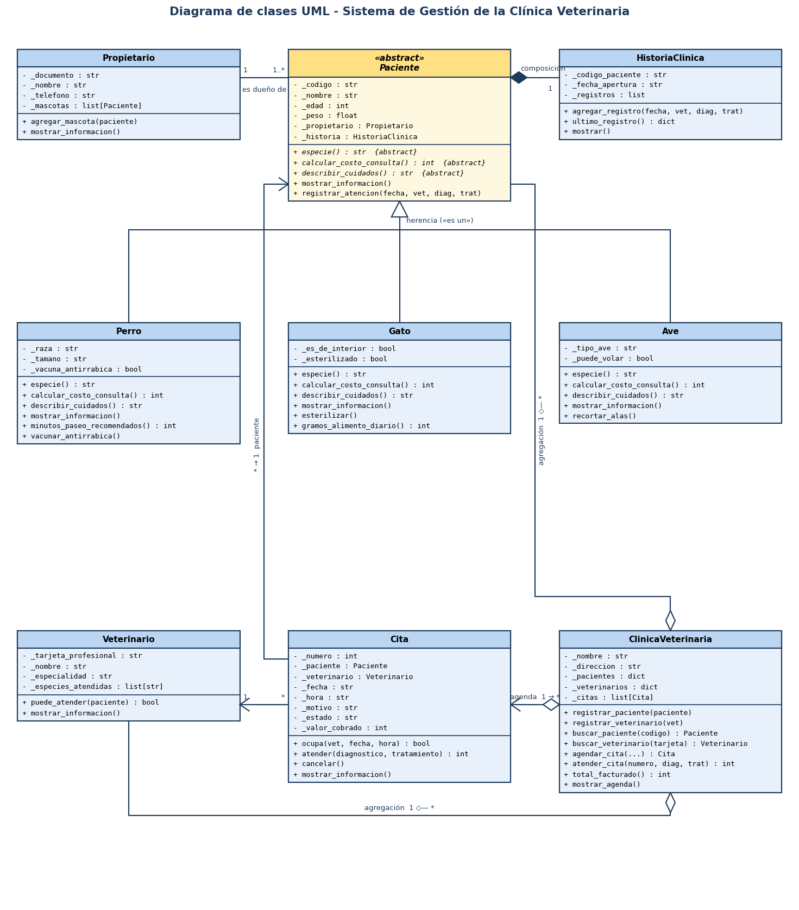

# Universidad de Manizales
## Facultad de Ciencias e Ingeniería · Programación I

### Actividad Colaborativa N°3 – Proyecto Final: Sistema de Gestión de una Clínica Veterinaria (POO en Python)

---

## Autor

| Nombre completo | Código |
|-----------------|--------|
| Juan Esteban Romero Mosquera | 82202524107 |

**Docente:** Natalia Marcela Castellano Gomez
**Fecha de entrega:** __/__/2026

---

## 1. Problema que resuelve

La **Clínica Veterinaria Huellitas** lleva hoy su agenda en un cuaderno. Eso causa tres problemas: se agendan dos citas al mismo veterinario a la misma hora, se asignan aves a veterinarios que no atienden animales exóticos, y la información de cada mascota (atenciones anteriores, diagnósticos) queda dispersa.

El sistema permite:

- Registrar **propietarios** y sus **mascotas** (perros, gatos y aves), cada una con su **historia clínica**.
- Registrar **veterinarios** con las especies que están habilitados para atender.
- **Agendar citas** comprobando que el veterinario exista, atienda esa especie y esté libre en ese horario.
- **Atender citas**: se registra el diagnóstico en la historia clínica y se cobra la consulta, cuyo valor depende de la especie.
- Consultar los **cuidados recomendados** para cada mascota y el **total facturado** por la clínica.

---

## 2. Estructura del proyecto

```
clinica-veterinaria/
├── main.py                     # Programa principal: casos normales y excepcionales
├── clinica/                    # Paquete con el modelo del sistema
│   ├── __init__.py             # Expone las clases del paquete
│   ├── pacientes.py            # Paciente (abstracta), Perro, Gato, Ave
│   ├── historia_clinica.py     # HistoriaClinica (composición con Paciente)
│   ├── personas.py             # Propietario, Veterinario
│   ├── cita.py                 # Cita
│   ├── clinica.py              # ClinicaVeterinaria
│   ├── excepciones.py          # Excepciones personalizadas
│   └── validaciones.py         # Funciones de validación reutilizadas
├── docs/
│   ├── diagrama_uml.png        # Diagrama UML de clases (imagen)
│   ├── diagrama_uml.md         # Diagrama UML en Mermaid (GitHub lo muestra)
│   └── Documento_Decisiones_Diseno_AC3.docx
├── README.md
└── .gitignore
```

---

## 3. Cómo ejecutar

**Requisito:** Python 3.8 o superior. No usa librerías externas.

```bash
python main.py
```

El programa tiene 10 secciones:

| # | Sección | Qué demuestra |
|---|---------|---------------|
| 1 | Clínica, propietarios y veterinarios | Creación de objetos |
| 2 | Registro de 6 pacientes | Objetos de las tres clases hijas |
| 3 | `Paciente(...)` directo | La clase abstracta no se puede instanciar (`TypeError`) |
| 4 | Datos inválidos | Encapsulamiento: los setters rechazan valores y el objeto conserva los anteriores |
| 5 | Lista heterogénea + un solo `for` | Polimorfismo |
| 6 | `vacunar_antirrabica()`, `esterilizar()`, `recortar_alas()` | Métodos propios de cada hija |
| 7 | Agenda de citas | Relaciones entre objetos |
| 8 | Cinco situaciones anormales | Excepciones personalizadas; el programa sigue ejecutándose |
| 9 | Atención de citas | Composición: la historia clínica de cada paciente se llena |
| 10 | Resumen | Propietarios con sus mascotas, agenda y total facturado |

---

## 4. Diagrama UML de clases



La versión en Mermaid está en [`docs/diagrama_uml.md`](docs/diagrama_uml.md).

---

## 5. Cumplimiento de los requerimientos

| Requerimiento | Dónde se cumple |
|---------------|-----------------|
| 6 clases concretas | `Perro`, `Gato`, `Ave`, `HistoriaClinica`, `Propietario`, `Veterinario`, `Cita`, `ClinicaVeterinaria` (8) |
| 1 clase abstracta | `Paciente` (hereda de `ABC`, 3 métodos abstractos) |
| 3 clases que heredan de una común | `Perro`, `Gato` y `Ave` heredan de `Paciente` |
| Constructores | Todas las clases tienen `__init__`; las hijas llaman a `super().__init__()` |
| Encapsulamiento | Atributos con `_`, acceso por `@property` con validación en los setters |
| Métodos propios | `Perro.vacunar_antirrabica()`, `Gato.esterilizar()`, `Ave.recortar_alas()`, entre otros |
| 2 métodos sobrescritos | `calcular_costo_consulta()`, `describir_cuidados()` (y además `mostrar_informacion()` y `especie`) |
| Colección heterogénea | Lista `pacientes` en la sección 5 de `main.py` |
| 2 relaciones entre objetos | `Propietario`–`Paciente`, `Cita`–`Paciente`/`Veterinario`, `ClinicaVeterinaria`–`Cita` |
| 1 composición | `Paciente` ◆ `HistoriaClinica` |
| 3 excepciones personalizadas | 5 excepciones en `clinica/excepciones.py` |
| 8 objetos | 1 clínica, 3 propietarios, 2 veterinarios, 6 pacientes, 6 historias clínicas y 7 citas |
| Programa principal | `main.py` |

---

## 6. Conceptos de POO aplicados

### 6.1 Herencia y especialización

`Paciente` reúne lo que comparten todas las mascotas: código, nombre, edad, peso, propietario e historia clínica, con sus validaciones. `Perro`, `Gato` y `Ave` **son** pacientes y agregan sus propios datos:

| Clase | Atributos propios | Métodos propios |
|-------|-------------------|-----------------|
| `Perro` | `raza`, `tamano`, `vacuna_antirrabica` | `minutos_paseo_recomendados()`, `vacunar_antirrabica()` |
| `Gato` | `es_de_interior`, `esterilizado` | `esterilizar()`, `gramos_alimento_diario()` |
| `Ave` | `tipo_ave`, `puede_volar` | `recortar_alas()` |

### 6.2 Clase abstracta

En la clínica no se atiende a "un paciente" sin especie: el precio y los cuidados dependen de qué animal es. Por eso `Paciente` es abstracta y declara `especie`, `calcular_costo_consulta()` y `describir_cuidados()` con `@abstractmethod`. Intentar `Paciente(...)` lanza `TypeError` (sección 3 de `main.py`).

### 6.3 Sobreescritura

| Método | Perro | Gato | Ave |
|--------|-------|------|-----|
| `calcular_costo_consulta()` | Base + recargo por tamaño (0 / 10.000 / 20.000) | Base + 15.000 si no está esterilizado | Base × 1,35 (paciente exótico) |
| `describir_cuidados()` | Minutos de paseo según tamaño; avisa si falta la antirrábica | Gramos de alimento según peso; desparasitación si sale al exterior | Jaula y sol según tipo de ave; precaución si puede volar |
| `mostrar_informacion()` | Llama a `super()` y agrega raza, tamaño y vacuna | Agrega hábitat y esterilización | Agrega tipo de ave y vuelo |

### 6.4 Polimorfismo

```python
pacientes = [max_, misu, kiwi, lola, tom, piolin]
for paciente in pacientes:
    paciente.mostrar_informacion()
    print(f"  Costo de consulta: {formato_pesos(paciente.calcular_costo_consulta())}")
    print(f"  Cuidados: {paciente.describir_cuidados()}")
```

Un solo ciclo, sin `isinstance()` ni `if` por tipo. El polimorfismo también aparece dentro del sistema: `Cita.atender()` cobra con `calcular_costo_consulta()` y `Veterinario.puede_atender()` compara `paciente.especie` sin conocer la clase del paciente.

### 6.5 Composición: `Paciente` ◆ `HistoriaClinica`

Cada paciente **crea su propia** historia clínica en el constructor:

```python
self._historia = HistoriaClinica(self._codigo)
```

La historia no se recibe desde fuera, no se comparte con otro paciente, no tiene setter y deja de existir con el paciente. No es herencia porque una historia clínica no **es** un paciente ni un paciente **es** una historia: el paciente **tiene** una historia.

Las demás relaciones son asociaciones o agregaciones, porque sus objetos existen por su cuenta: el propietario, el veterinario y la clínica se crean antes y por separado.

### 6.6 Excepciones personalizadas

Todas heredan de `ErrorClinicaVeterinaria` (`clinica/excepciones.py`):

| Excepción | Se lanza en | Situación |
|-----------|-------------|-----------|
| `HorarioNoDisponibleError` | `ClinicaVeterinaria.agendar_cita()` | El veterinario ya tiene una cita programada en esa fecha y hora |
| `EspecieNoAtendidaError` | `ClinicaVeterinaria.agendar_cita()` | El veterinario no atiende la especie del paciente |
| `PacienteNoEncontradoError` | `ClinicaVeterinaria.buscar_paciente()` | El código de paciente no está registrado |
| `VeterinarioNoEncontradoError` | `ClinicaVeterinaria.buscar_veterinario()` | La tarjeta profesional no existe |
| `CitaYaAtendidaError` | `Cita.atender()` / `Cita.cancelar()` | Se intenta atender o cancelar una cita ya atendida |

En `main.py` (sección 8) cada una se captura con `try/except`, se muestra el mensaje y se ejecuta una operación válida después, para comprobar que el sistema continúa.

---

## 7. Documento de Decisiones de Diseño

[`docs/Documento_Decisiones_Diseno_AC3.docx`](docs/Documento_Decisiones_Diseno_AC3.docx)

---

## 8. Declaración del uso de herramientas de Inteligencia Artificial

| Aspecto | Detalle |
|--------|---------|
| **Herramienta utilizada** | Claude (Anthropic), mediante Claude Code |
| **Fecha de uso** | 09/11/2026 |
| **Propósito** | Apoyo en la propuesta del dominio y de las clases, generación del código, del diagrama UML y redacción de la documentación. |
| **Revisión humana** | El autor revisó, ejecutó y comprendió el código, y verificó que cumpliera cada requerimiento del enunciado. |

El autor declara que comprende el funcionamiento de todo el código entregado, que puede explicarlo y sustentarlo, y que asume la responsabilidad total por el contenido de esta entrega.
