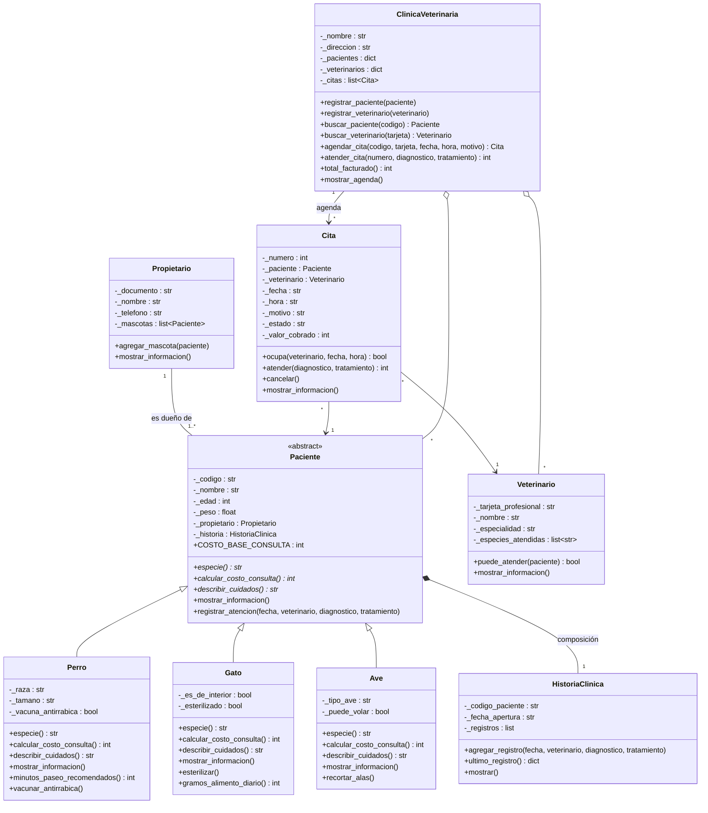
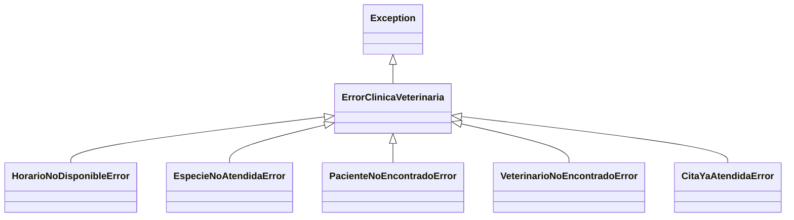

# Diagrama UML de clases

GitHub muestra este diagrama como imagen. También está exportado en [`diagrama_uml.png`](diagrama_uml.png).

## Jerarquía de excepciones

Notación: `*` después de un método indica método abstracto; `◆` (`*--`) es composición, `◇` (`o--`) agregación y `-->` asociación.
